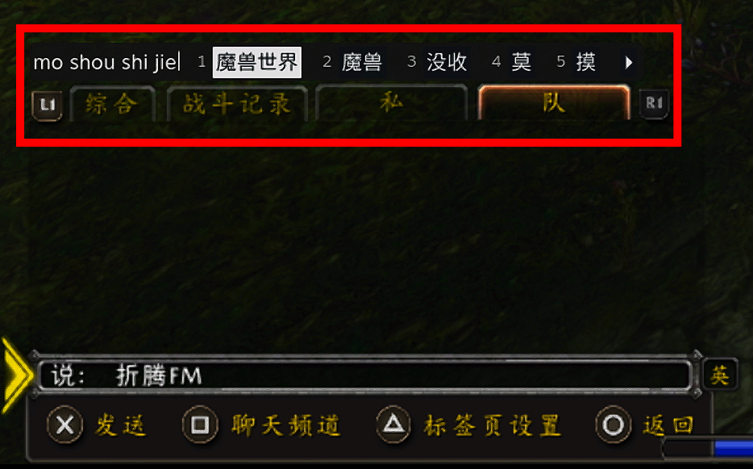

# WoWDeck Input｜魔兽掌机输入法

[简体中文](README.md) | **English**

**Type Chinese with a physical keyboard in Steam Deck Gaming Mode.**

WoWDeck Input is a [Decky Loader](https://github.com/SteamDeckHomebrew/decky-loader) plugin that connects a physical keyboard to Steam's native keyboard and the system Pinyin engine. It supports full Pinyin, Xiaohe double Pinyin, and a compact candidate bar.

The project began as a way to chat in *World of Warcraft: Forever*. It does not require an in-game WoW addon. The current version is **0.1.3, a test release**.



*In-game example: the compact candidate bar can be positioned independently. The red outline highlights it for this screenshot.*

## Features

- **Full Pinyin and Xiaohe double Pinyin:** new installations default to full Pinyin; switch schemes in the plugin settings.
- **In-game shortcut:** press `Ctrl + Space` instead of reaching for the Deck's `Steam + X` buttons.
- **Chinese / English switching:** tap either `Shift` key. `Shift + letter` still works for uppercase typing.
- **Compact candidate bar:** hide the full on-screen keyboard and choose numbered candidates with Space or number keys.
- **Adjustable appearance:** move the candidate bar and change its size and transparency. Preferences are saved.
- **Recordable shortcuts:** customize the activation and adjustment shortcuts, with conflict checks between them.
- **First-use checks:** detect the system Chinese engine and Steam's enabled Simplified Chinese keyboard separately, with setup guidance when needed.
- **Handheld keyboard preserved:** without a physical keyboard, `Steam + X` still opens Steam's full on-screen keyboard.

## Installation

The plugin's settings UI is currently in Simplified Chinese. Relevant Chinese button labels are included below.

### 1. Install Decky Loader

Decky Loader is required. Skip this step if it is already installed.

Follow the [official Decky installation instructions](https://github.com/SteamDeckHomebrew/decky-loader#installation). The stable version is recommended. Installing Decky for the first time usually requires Desktop Mode; return to Gaming Mode afterward.

### 2. Import the plugin ZIP

1. Download `WoWDeck-Input-0.1.3.zip` from this repository's [Releases page](https://github.com/iCodyYang/WoWDeck-Input/releases) and save it on your Deck, for example in Downloads.
2. **Do not extract it.** Do not select the `-source` archive or GitHub's automatically generated “Source code” archives.
3. In Gaming Mode, press the right-side **…** button, open the **Decky plug icon**, and select the **settings cog**.
4. Enable **Developer Mode** under **General**. This is Decky's own setting.
5. Go to **Developer → Third-party plugins → Install Plugin from ZIP → Browse**, select the archive, and confirm installation.
6. Return to the Decky plugin list and open **WoWDeck Input**.

If **Better Keyboard** is already installed, disable it in Decky before enabling WoWDeck Input so the two plugins do not capture the same keyboard.

> Installation currently uses a ZIP file. This plugin is not listed in the official Decky Plugin Store.

### 3. Check your Chinese keyboard setup

In **First-use checks / 首次使用检查**, confirm that both are ready:

- The system Chinese input engine.
- Steam's Simplified Chinese keyboard.

If the Chinese keyboard is not enabled, click **Open Steam keyboard settings / 打开 Steam 键盘设置**, then follow:

**Steam → Settings → Keyboard → Active Keyboards → Edit → enable “Simplified Chinese (Pinyin)” → confirm.**

Return to the plugin, click **Check again / 重新检测**, and turn on **Enable input enhancement / 启用输入增强**. Labels may differ slightly between Steam versions.

**Chinese keyboard setup takes place in Gaming Mode. It does not require Desktop Mode, Fcitx configuration, SSH, or terminal commands.** If the detection interface is unavailable, the plugin asks you to check manually. It does not treat an installed engine as proof that the Chinese keyboard is enabled.

## Usage

Focus the game's chat input first, then press and release the activation shortcut.

| Default key | Action |
| --- | --- |
| `Ctrl + Space` | Open the physical-keyboard input interface |
| Tap either `Shift` | Switch between Chinese and English |
| `Space` or a number key | Select a candidate |
| `F8` | Show adjustment controls; press again to save and hide them |
| `Esc` | Close the input interface |
| `Steam + X` | Open Steam's native keyboard; the full keyboard is shown when no physical keyboard is connected |

### Adjust the candidate bar

1. Open the input interface and press `F8`.
2. Drag the adjustment bar to move the candidates.
3. Use the sliders to change size and transparency.
4. Press `F8` again to save and hide the controls.

Showing or hiding the controls does not shift the candidates. During normal use, the candidate bar appears only when candidates are available; there is no persistent language-status or adjustment toolbar.

### Change shortcuts

In the plugin settings, click **Activate input / 唤醒输入界面** or **Adjust candidate bar / 调整候选框**, press your preferred combination, and release all keys.

- Supports combinations using `Ctrl`, `Alt`, or `Shift`, or a single `F1–F12` key.
- The activation and adjustment shortcuts cannot be identical.
- Press `Esc` to cancel recording. Recording times out after 20 seconds.
- A reset button restores `Ctrl + Space` and `F8`.

### Switch Pinyin schemes

Under **Chinese input scheme / 中文输入方案**, choose **Full Pinyin / 全拼** or **Xiaohe double Pinyin / 小鹤双拼**. Xiaohe is a scheme supported by the system IBus Pinyin engine; a separate Xiaohe input-method application is not required.

Finish or cancel any pending composition and close the input interface before switching. The setting belongs to the system IBus engine and may affect other applications using that engine. It is separate from Desktop Mode's Fcitx configuration.

## FAQ

**Can I use this without setting up Chinese input in Desktop Mode?**

Yes. Steam's Gaming Mode keyboard is configured separately from desktop input methods. Enable Simplified Chinese through the first-use guide; a desktop input method is not required.

**Which scheme is used by default?**

New installations default to full Pinyin, applied when input enhancement is first enabled. Users migrating from this project's earlier version retain their existing scheme.

**Why does F8 do nothing?**

Open the input interface first. The adjustment shortcut is active only within the physical-keyboard input interface. Some keyboards require `Fn + F8` to send F8; you can also record a different shortcut in the plugin.

**What if the Chinese engine is missing?**

Enable Simplified Chinese in Steam's Gaming Mode keyboard settings and check again. If the engine is still reported missing, check for SteamOS updates and include your version information in a bug report. The plugin does not install system packages or modify the read-only system partition.

**Does it work in every game?**

Basic Chinese input, Shift switching, candidate adjustment, and first-use checks have been verified on a Steam Deck LCD in *World of Warcraft: Forever*. Other games, OLED devices, and additional system versions still need testing. Text-input compatibility is not guaranteed for every game. See [validation notes](VALIDATION.md), currently in Chinese, for the detailed scope.

## Restore and uninstall

- **Reset candidate position and style / 重置候选框位置和样式:** restore the default appearance in the plugin settings.
- **Restore the input scheme:** the plugin backs up the relevant system Pinyin settings before its first actual scheme change. Use **Restore the system input scheme from before the first switch / 恢复首次切换前的系统输入方案** to restore them.
- **Uninstall:** remove WoWDeck Input through Decky. The backup is restored automatically only if the system settings still match the plugin's last applied values, preserving changes made afterward.

Disabling or uninstalling releases captured keyboard devices. Decky may retain the plugin's settings files; uninstalling does not necessarily erase all preferences.

## Privacy

The plugin does not log typed text or upload keystrokes. It does not require a cloud service or API key. Input is handled by Steam's native input components.

Decky stores preferences locally, including shortcuts, the selected scheme, and candidate appearance. Release archives do not contain the developer's personal settings, credentials, or device backups.

## Development

You need Node.js, npm, and Python 3. Run:

```bash
npm install
npm run typecheck
npm test
npm run build
python3 build_release.py
```

Artifacts are generated in `release/`:

- `WoWDeck-Input-0.1.3.zip`: the installable Decky plugin.
- `WoWDeck-Input-0.1.3-source.zip`: source code and build scripts.
- `SHA256SUMS.json`: archive checksums.

Dependencies, caches, user preferences, and backups are excluded from release archives. Steam client updates can change the native keyboard interfaces and may require plugin updates.

## Report an issue

Please include the following in an [Issue](https://github.com/iCodyYang/WoWDeck-Input/issues):

- Steam Deck LCD / OLED, SteamOS version, and Decky version.
- Plugin version, keyboard model, and the affected game or application.
- First-use check results and steps to reproduce the problem.

Do not include chat contents, credentials, or complete personal configuration files.

## Credits and license

This project builds on the physical keyboard mapping and Steam keyboard integration approach of [Chenx Dust / BetterKeyboard](https://github.com/chenx-dust/BetterKeyboard). Original copyright notices for Chenx Dust and Steam Deck Homebrew are retained.

- Project license: [BSD 3-Clause](LICENSE).
- Input device library license: [python-evdev](py_modules/evdev_mod/LICENSE.python-evdev).
- Attribution and development details: [NOTICE.md](NOTICE.md).

Generative AI assisted development of this project, including substantial AI-authored additions. See NOTICE.md for details.
