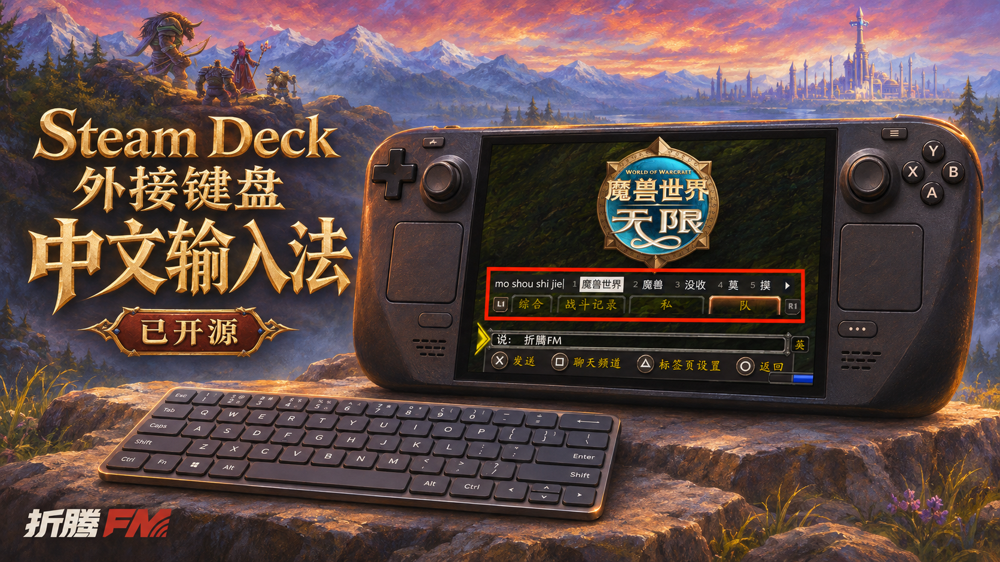

# WoWDeck Input｜魔兽掌机输入法

**简体中文** | [English](README.en.md)

**在 Steam Deck 上，用外接键盘轻松打中文。**



WoWDeck Input 是一款面向 Steam Deck 游戏模式的 [Decky Loader](https://github.com/SteamDeckHomebrew/decky-loader) 插件。它使用 Steam 原生键盘与系统拼音引擎，让外接键盘支持全拼、小鹤双拼和精简候选框。

这个项目从《魔兽世界：无限》的聊天需求出发开发，不需要安装魔兽游戏内插件。当前为 **0.1.3 测试版**。


*游戏内显示示例：精简候选词条可独立定位；红框为展示标注。*

## 功能

- **全拼与小鹤双拼**：新用户默认全拼，在插件设置中即可切换方案。
- **游戏内快捷唤醒**：默认 `Ctrl + 空格`，不用再伸手按掌机上的 `Steam + X`。
- **中英文切换**：短按左、右任一 `Shift` 切换；`Shift + 字母` 保留正常大写输入。
- **精简候选框**：隐藏完整屏幕键盘，候选词带有 `1、2、3…` 编号，可用空格或数字选词。
- **自定义显示**：调整候选框的位置、大小和透明度，自动记住设置。
- **可录制快捷键**：唤醒键、候选框调整键均可修改，并检查两者是否冲突。
- **首次使用检查**：分别检测系统中文引擎与 Steam 简体中文键盘，未启用时提供设置引导。
- **保留掌机输入**：没有外接键盘时，`Steam + X` 仍显示原生完整屏幕键盘。

## 安装

### 1. 安装 Decky Loader

本插件需要 Decky Loader。已经安装的用户直接跳到下一步。

尚未安装的用户，请按 [Decky 官方中文安装说明](https://github.com/SteamDeckHomebrew/decky-loader/blob/main/README_zh-Hans.md)操作，建议选择稳定版。首次安装 Decky 通常需要进入桌面模式，完成后返回游戏模式。

### 2. 导入插件 ZIP

1. 从本仓库的 [Releases 页面](https://github.com/iCodyYang/WoWDeck-Input/releases)下载 `WoWDeck-Input-0.1.3.zip`，保存到 SD，例如“下载 / Downloads”目录。
2. **不要解压**，也不要选择带 `-source` 的源码包或 GitHub 自动生成的“Source code”压缩包。
3. 在游戏模式按右侧 **…** 按钮，进入 **Decky 插头图标 → 齿轮设置**。
4. 在 **常规** 页面开启 **开发者模式**。这是 Decky 自己的选项。
5. 进入 **开发者 → 第三方插件 → 从 ZIP 压缩文件安装插件 → 浏览文件**，选择安装包并确认。
6. 返回 Decky 插件列表，打开 **WoWDeck Input**。

如果已经安装 **Better Keyboard**，请先在 Decky 中停用它，再启用 WoWDeck Input，避免两个插件同时接管键盘。

> 当前通过 ZIP 安装，尚未上架 Decky 官方插件商城。

### 3. 完成中文键盘检查

打开插件的 **首次使用检查**，确认这两项已就绪：

- 系统中文引擎。
- Steam 简体中文键盘。

如果没有启用中文键盘，点击插件中的 **打开 Steam 键盘设置**，按以下路径添加：

**Steam → 设置 → 键盘 → 当前键盘 / 启用的键盘 → 编辑 → 勾选“简体中文（拼音）”→ 确认。**

返回插件后点击 **重新检测**，然后开启 **启用输入增强**。

**中文键盘直接在游戏模式设置，无需切换 Linux 桌面、配置 Fcitx、使用 SSH 或输入终端命令。** 如果检测接口暂时不可用，插件会提示手动核对，不会把“有中文引擎”误报成“已启用中文键盘”。

## 开始使用

先把光标放到游戏的聊天输入框，再按下并松开唤醒快捷键。

| 默认按键 | 功能 |
| --- | --- |
| `Ctrl + 空格` | 唤醒外接键盘输入界面 |
| 短按左 / 右 `Shift` | 切换中英文 |
| `空格` 或数字键 | 选择候选词 |
| `F8` | 打开候选框调整栏；再按一次保存并隐藏 |
| `Esc` | 关闭输入界面 |
| `Steam + X` | 呼出 Steam 原生键盘；无外接键盘时显示完整键盘 |

### 调整候选框

1. 打开输入界面，按 `F8` 进入调整模式。
2. 拖动调整栏，移动候选框。
3. 使用滑块调整大小和透明度。
4. 再按一次 `F8`，保存并隐藏调整栏。

调整栏出现或隐藏不会挤动候选词的位置。平时只在有候选词时显示候选框，不常驻中英文状态栏或调整按钮。

### 修改快捷键

在插件设置中点击 **唤醒输入界面** 或 **调整候选框**，按下希望使用的组合键，再全部松开。

- 支持 `Ctrl`、`Alt`、`Shift` 组合键，或单独的 `F1–F12`。
- 唤醒键与调整键不能相同。
- `Esc` 取消录制，20 秒未完成会自动超时。
- 可以一键恢复默认的 `Ctrl + 空格` 与 `F8`。

### 切换全拼与小鹤

在 **中文输入方案** 中选择 **全拼** 或 **小鹤双拼**。系统 IBus 拼音引擎已包含小鹤方案，无需另装一个“小鹤输入法”。

切换前请先选词或取消当前输入，并关闭输入界面。这项设置使用的是系统 IBus，可能影响其他使用同一引擎的应用；它与桌面端 Fcitx 的配置是分开的。

## 常见问题

**没配置过桌面中文输入，能用吗？**

可以。游戏模式的 Steam 中文键盘与桌面输入法分开配置，按首次使用引导启用简体中文即可。插件不要求安装桌面输入法。

**新安装默认是什么输入方案？**

默认全拼，首次启用时自动配置。迁移本项目旧版的用户保留原输入方案。

**按 F8 没反应？**

先用唤醒快捷键打开输入界面，调整快捷键只在外接键盘输入界面内生效。部分键盘需要按 `Fn + F8` 才会发送 F8，也可以在插件中改成其他快捷键。

**检查提示缺少中文引擎怎么办？**

先在游戏模式的 Steam 键盘设置中启用简体中文，再返回重新检测。如果仍然提示缺失，请检查 SteamOS 更新，并在反馈中附上版本信息。插件不会自行安装系统软件或修改系统只读分区。

**所有游戏都能用吗？**

目前已在 Steam Deck LCD 的《魔兽世界：无限》中验证基本中文输入、Shift 切换、候选框调整和首次使用检查。其他游戏、OLED 机型及更多系统版本仍需测试，不保证所有游戏都能接收相同的文字输入。详细范围见 [验证记录](VALIDATION.md)。

## 恢复与卸载

- **重置候选框位置和样式**：在插件内恢复默认显示设置。
- **恢复输入方案**：插件会在首次实际切换前备份系统拼音设置，可通过“恢复首次切换前的系统输入方案”按钮恢复。
- **卸载**：在 Decky 中卸载 WoWDeck Input。只有系统设置仍等于插件最后写入的值时，插件才自动恢复备份，避免覆盖用户后来做出的修改。

停用或卸载插件时会释放键盘设备。Decky 可能保留插件设置文件，卸载不代表清除全部个人配置。

## 隐私

插件不记录输入文字、不上传按键，也不需要云端服务或 API 密钥。键盘输入交给 Steam 原生输入组件处理。

配置由 Decky 保存在本机，包括快捷键、输入方案和候选框样式。发行包不包含开发者的个人设置、凭据或设备备份。

## 开发

需要 Node.js、npm 与 Python 3。安装前端依赖后运行：

```bash
npm install
npm run typecheck
npm test
npm run build
python3 build_release.py
```

构建产物在 `release/`：

- `WoWDeck-Input-0.1.3.zip`：供用户导入 Decky 的安装包。
- `WoWDeck-Input-0.1.3-source.zip`：包含源码及构建脚本的压缩包。
- `SHA256SUMS.json`：安装包和源码包的校验值。

`node_modules`、缓存、用户配置和备份不会打入发行包。Steam 客户端更新可能改变原生键盘接口，需要持续维护兼容性。

## 反馈问题

请在本仓库的 [Issues](https://github.com/iCodyYang/WoWDeck-Input/issues) 中说明：

- Steam Deck LCD / OLED、SteamOS 与 Decky 版本。
- 插件版本、键盘型号，以及问题发生在哪个游戏或应用。
- “首次使用检查”的结果和复现步骤。

请勿提交聊天正文、账号凭据或完整个人配置文件。

## 来源与许可

本项目基于 [Chenx Dust / BetterKeyboard](https://github.com/chenx-dust/BetterKeyboard) 的物理键盘映射与 Steam 原生键盘集成方式开发，保留原作者及 Steam Deck Homebrew 的版权声明。

- 项目许可证：[BSD 3-Clause](LICENSE)。
- 所复用输入设备库的许可：[python-evdev](py_modules/evdev_mod/LICENSE.python-evdev)。
- 来源及开发说明：[NOTICE.md](NOTICE.md)。

本项目使用了生成式 AI 辅助开发，包含大量 AI 编写的新增代码；具体说明见 NOTICE.md。
