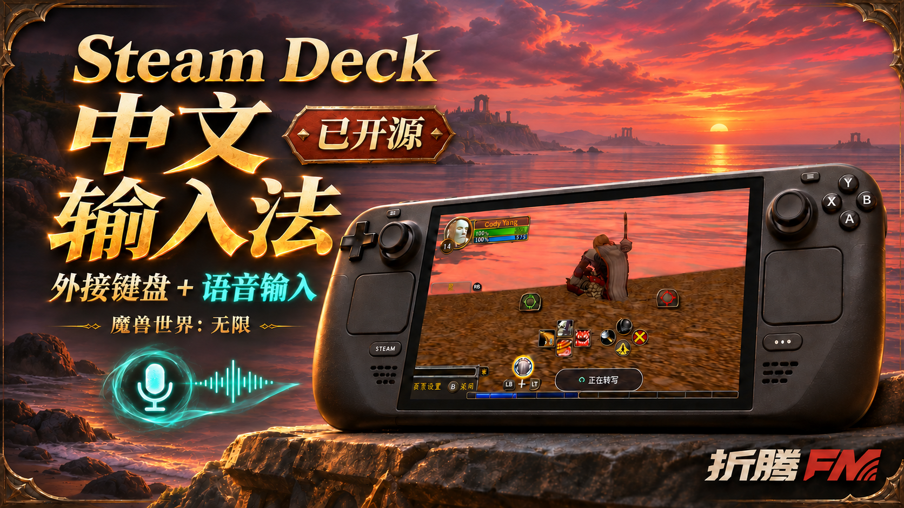
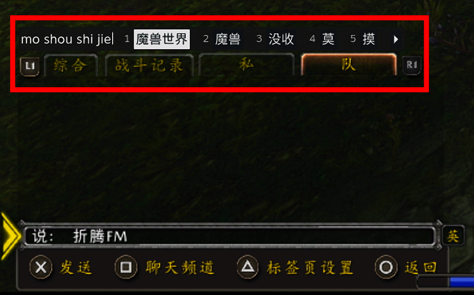

# 《魔兽世界》：“无限” Steam Deck 中文输入法

**简体中文** | [English](README.en.md)

**在 Steam Deck 游戏模式下玩《魔兽世界》：“无限”时，支持中文语音输入+外接键盘**



[下载 v2.0.1 安装包](https://github.com/iCodyYang/WoWDeck-Input/releases/download/v2.0.1/WoWDeck-Input-2.0.1.zip) · [全部发行文件](https://github.com/iCodyYang/WoWDeck-Input/releases/tag/v2.0.1) · [语音使用指南](docs/VOICE.md) · [安装说明](INSTALL.md)

WoWDeck Input 是面向 Steam Deck 游戏模式的 [Decky Loader](https://github.com/SteamDeckHomebrew/decky-loader) 插件，提供两项可以独立开关的功能：

- **实体键盘中文输入**：支持外接键盘和兼容掌机的机身键盘，全拼、小鹤双拼与可选的五笔 86。
- **语音输入**：使用自己的豆包账号扫码登录，按住 F7 或映射为 F7 的背键说话，松开后将文字填入游戏输入框。

当前版本为 **2.0.1**。安装包不带任何人的登录态；每位使用者登录自己的账号。

## 安装与升级

1. 先安装 Decky Loader；已有 Decky 可跳过。首次安装 Decky 请按[官方中文说明](https://github.com/SteamDeckHomebrew/decky-loader/blob/main/README_zh-Hans.md)操作，可能需要进入桌面模式。
2. 下载 **`WoWDeck-Input-2.0.1.zip`**，不要解压，也不要选择 `-source` 包或 GitHub 自动生成的 “Source code”。
3. 在游戏模式打开 **… → Decky 插头图标 → 齿轮设置**，在 **常规** 中开启 **开发者模式**。
4. 进入 **开发者 → 第三方插件 → 从 ZIP 压缩文件安装插件 → 浏览文件**，选择安装包并确认。也可以在“从 URL 安装”中粘贴上面的安装包直链。
5. 回到插件列表，打开 **WoWDeck Input**，开启 **总开关**，按需要分别开启键盘或语音。

已有 Decky 的安装、升级及扫码步骤均可在游戏模式完成。插件目前通过 ZIP 发布，未上架 Decky 官方插件商城。如果已安装 Better Keyboard，请先停用它，避免重复接管同一把键盘。

升级保留已有快捷键、输入方案、外观和本机账号资料。从 0.1.x 升级后，请检查新增的总开关，语音需主动开启；从近期语音测试版升级会保留现有独立开关。无需先卸载，不会自动切换成五笔。详见 [安装与升级说明](INSTALL.md)。

## 语音输入：扫码后按住说话

**不需要先按 Ctrl＋空格，也不需要连接外接键盘。**

1. 开启 **总开关 → 语音输入 → 启用语音输入**，打开 **语音设置**。
2. 等待二维码出现，用手机按页面提示扫码确认，看到 **账号已登录** 和 **就绪**。
3. 在对应游戏的 Steam Input 布局中，把一颗背键（L4、L5、R4、R5 均可）设置为键盘 **F7 → 普通按压**。不要设成长按触发、切换保持或连发。外接键盘可直接按 F7。
4. 选中游戏聊天输入框，**按住背键说话，松开结束**。录音时显示声音波形，随后显示“正在转写”，完成后自动填入草稿。

| 操作 | 功能 |
| --- | --- |
| 长按 F7 / 对应背键 | 录音 |
| 松开 F7 / 对应背键 | 完成识别并填入当前输入框，不自动发送 |
| 转写中再按一次 | 取消本次转写与填入 |
| 填入后快速按两次 | 清空刚填入的文字 |

- **自定义听写键**：在语音设置中选择空闲功能键，再同步修改背键映射。遇到只闪一下的情况，用“检测背键映射”核对实际按键与普通按压设置。
- **波形位置与透明度**：在“调整波形位置和透明度”中拖动预览或调整滑块，不透明度为 20%–100%。
- **关闭与登录**：关闭语音或总开关会停止服务并保留登录资料。需要换账号时选择“退出登录”，之后重新扫码即可。

语音开关开启表示待命，按住听写键期间才录音。语音需要网络和豆包网页服务；普通键盘输入与五笔不依赖豆包账号。

完整步骤及故障排查见 **[语音输入使用指南](docs/VOICE.md)**。

### 可选：魔兽双击清空组件

基础语音输入不需要游戏组件。**双击清空草稿**目前仅适配《魔兽世界：无限》，需要 **WoWDeckDraft 0.2.3**：

1. 进入游戏，在 **语音设置** 点击 **安装或更新魔兽双击清空组件**。
2. 完整退出并重新进入魔兽，让组件生效。
3. 语音填入后快速点两下同一听写键，即可清空刚填入、尚未发送的当前草稿，再按住重说。

也可从 Release 下载 `WoWDeckDraft-2.0.1.zip` 手动安装到对应游戏的 `Interface/AddOns/`。压缩包随主版本编号，组件内部版本仍为 0.2.3，已安装该组件的测试版用户无需重复更新。

这不是任意输入框的通用撤销。发送消息、切换聊天框或改变草稿后，旧草稿的清空资格会失效。游戏内没有常驻“清空”或“拖动”按钮。

## 实体键盘中文输入



*键盘候选框展示，红框为示意标注。*

1. 开启总开关，进入 **外接键盘输入法 → 外接键盘设置**。该功能也适用于兼容掌机的机身实体键盘。
2. 使用全拼或小鹤时，确认系统中文引擎和 Steam 简体中文键盘已就绪。未启用时点击 **打开 Steam 键盘设置**，在 **Steam → 设置 → 键盘 → 当前键盘／启用的键盘 → 编辑** 中勾选 **简体中文（拼音）**。
3. 返回插件，点击 **重新检测**，开启 **启用外接键盘输入法**。
4. 把光标放到游戏输入框，按下并松开 **Ctrl＋空格**，开始输入。

全拼、小鹤使用系统 IBus，游戏模式与桌面的 Fcitx 配置分开；无需为了本插件配置桌面输入法。

| 默认按键 | 功能 |
| --- | --- |
| Ctrl＋空格 | 唤醒实体键盘输入界面 |
| 短按左 / 右 Shift | 切换中英文；Shift＋字母保留大写输入 |
| 空格或数字键 | 选择候选词 |
| F8 | 打开候选框调整栏；再次按下保存并隐藏 |
| Esc | 取消输入 / 关闭界面 |
| Steam＋X | 使用 Steam 原生触屏键盘 |

在设置中可以录制新的唤醒键和调整键。两个快捷键不能相同，也不能与启用中的听写键冲突。候选框支持移动、大小和透明度调整；修改全拼 / 小鹤方案前，请先关闭输入界面。系统拼音方案的修改可能影响其他使用同一 IBus 引擎的应用。

### 可选五笔 86

路径：**外接键盘设置 → 中文输入方案 → 五笔 86（试用）**。升级不会自动选用。

- 使用随包离线码表，只在主动选用时加载；不安装系统五笔服务，不改变全拼 / 小鹤设置。
- A–Y 编码，空格选首个候选，1–5 选当前页候选，`-` / `=` 或 PageUp / PageDown 翻页；四码且只有一个候选时自动填入。
- 退格修改编码，Esc 取消，短按 Shift 切换中英文；Enter 确认原始字母编码，不自动发送聊天。
- 只作用于插件唤醒的实体键盘输入，不替换 Steam 触屏键盘。暂不包含五笔 98、新世纪、拼音反查或个人词频学习。

五笔仍标为试用，需继续真机验证；接口不兼容时会退出本次输入并提示，可切回全拼或小鹤。

## 兼容性与常见问题

**支持哪些设备？**

主要开发环境为 Steam Deck LCD 的 SteamOS 游戏模式。实体键盘按按键能力识别，覆盖 USB、蓝牙、PS/2、I2C 和 SPI。已有 GPD Win Mini HX 370 使用者反馈外接键盘问题解决，但这不代表该机型的语音和五笔已经验收。更多机型、系统镜像与游戏仍需验证，见 [验证范围](docs/RELEASE_VALIDATION.md)。

**Ctrl＋空格没有反应？**

点击总开关下方 **重新检测键盘（不改变开关）**，查看检测结果。检查总开关、键盘开关和简体中文键盘是否已启用，并在快捷键录制处确认实际按键。手柄端点和虚拟输入设备不会被当作实体键盘接管；系统映射工具独占设备的情况可能需要进一步适配。

**二维码不出现、背键波形只闪一下、转写或填入失败？**

见 [语音故障排查](docs/VOICE.md#常见问题)。语音依赖系统 Qt 6 WebEngine、parec、X11、GTK 3 和 xdotool；缺少组件的镜像会显示提示，插件不会自动改系统只读分区。语音不可用时，可单独使用键盘输入法。

**升级会不会改变现在的用法？**

升级保留已有快捷键、输入方案、外观和独立开关；五笔为可选功能。发布前做旧配置、菜单优先、键盘与 F7 回归检查，但自动检查不等于所有设备和游戏均已验收。

## 隐私与账号

- 键盘与五笔在本机处理。语音按键期间的音频经豆包网页服务识别，项目不提供共享账号或中转服务器。
- 登录资料保存在各自设备；安装包、源码包和 GitHub 仓库不包含个人账号、Cookie、设置、录音或设备备份。
- 语音填入使用系统剪贴板，会替换当前剪贴板内容，保留最新一句供游戏读取；不会自动恢复上次的话。
- 插件不把听写正文写入自己的历史记录。反馈问题时不要发送账号文件、聊天正文或录音。

详情见 [登录与隐私说明](PRIVACY.md)。

## 恢复与卸载

设置中可以重置候选框，或恢复首次切换前备份的系统拼音方案。卸载时，只有系统拼音仍等于插件最后写入的值，才自动恢复备份，避免覆盖用户后来的修改。

在 Decky 中卸载会释放键盘；Decky 可能保留设置文件。若需删除插件专用登录资料，请先在语音设置中 **退出登录**。

## 开发与构建

需要 Node.js、npm 和 Python 3：

```bash
npm install
npm run typecheck
npm test
npm run build
python3 build_release.py
```

`release/` 中生成安装 ZIP、完整源码 ZIP、可选聊天组件 ZIP、`SHA256SUMS.json` 和 `RELEASE_AUDIT.json`。构建使用明确的源文件清单，不导出已登录设备目录。聊天组件的内部版本与主插件版本独立。

## 反馈与许可

请在 [Issues](https://github.com/iCodyYang/WoWDeck-Input/issues) 提供机型、SteamOS、Decky、插件版本、键盘型号、游戏和复现步骤，不要提交个人资料目录。

- 应用代码：[BSD 3-Clause](LICENSE)。物理键盘映射和 Steam 集成基于 [BetterKeyboard](https://github.com/chenx-dust/BetterKeyboard)，保留原版权声明。
- 输入设备库：[python-evdev 许可](py_modules/evdev_mod/LICENSE.python-evdev)。
- 语音实现参考：[Doubao Murmur](https://github.com/lilong7676/doubao-murmur)，保留其 [MIT 许可](voice/LICENSE-Murmur.txt) 和来源记录。
- 五笔码表来自 [Rime 五笔](https://github.com/rime/rime-wubi)，保留 [LGPL v3](data/wubi86/LICENSE)、[GPL v3](data/wubi86/COPYING.GPL3)、作者和固定版本记录；码表与 BSD 应用代码分别许可。

本项目使用生成式 AI 辅助开发；来源、许可和开发说明见 [NOTICE.md](NOTICE.md)。本项目不是豆包或 Valve 的官方插件。
